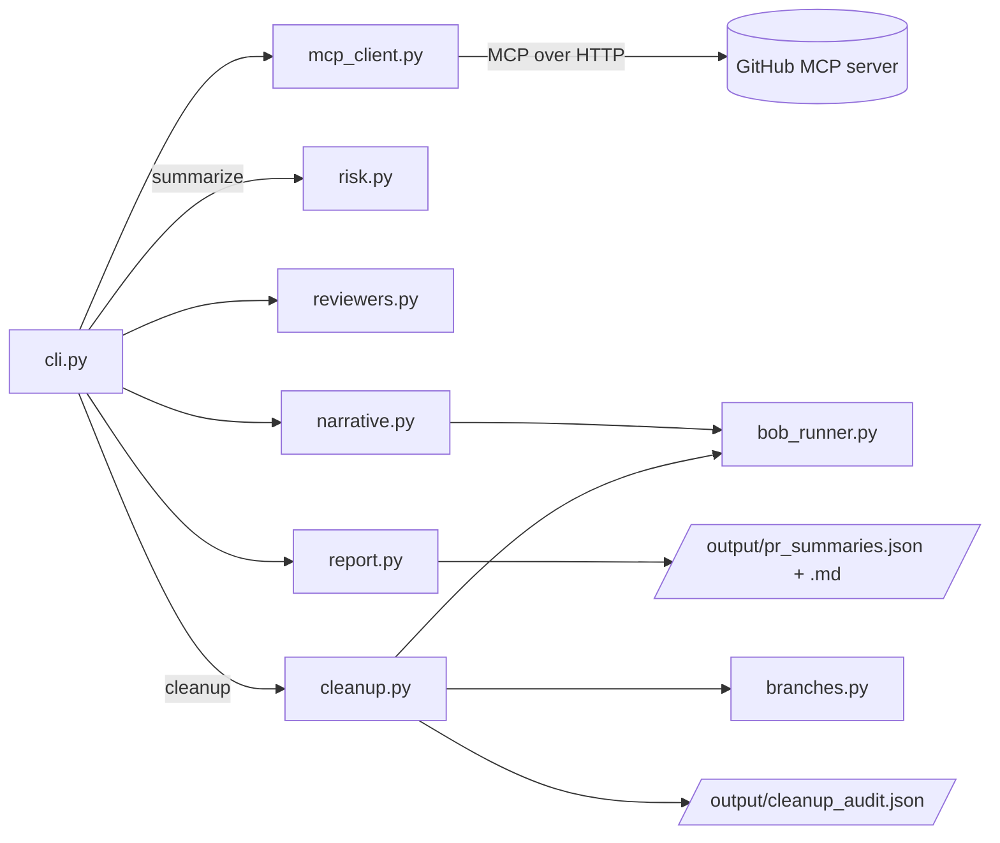

# Automated PR Assistant

AI-autonomous GitHub integration via MCP for continuous SDLC operations.

The tool connects to a live GitHub repository through the **remote GitHub MCP server** and:

1. **Reads all open pull requests.**
2. **Writes a review summary for each PR:** title, changed files, risk flag and suggested reviewers.
3. **Deletes merged branches older than 7 days** through Bob Shell, with no manual git commands.

The risk flag and the reviewers come from **fixed rules**, not from the AI. Bob only writes a short narrative summary and runs the branch deletion.

## Team

| Member | Name | Role |
|---|---|---|
| 1 | Nanda | Repo, test data, end-to-end testing and recording |
| 2 | Karthik | Test cases, verification and documentation |
| 3 | Lalit | Developer: foundation and MCP |
| 4 | Kumar | Developer: PR summary pipeline |
| 5 | Aneesh | Developer: branch cleanup and Orchestrate |

## Status

| Area | Owner | Status |
|---|---|---|
| Project skeleton, config, models, CLI | Lalit (Member 3) | Done |
| GitHub MCP client (`mcp_client.py`) and tests | Lalit (Member 3) | Done |
| `.bob/mcp.json` | Lalit (Member 3) | Tested in Bob Shell 2.1.0: connects, 46 tools. Uses `${env:GITHUB_TOKEN}` |
| Risk, reviewers, narrative, report | Kumar (Member 4) | To do |
| Bob runner, branches, cleanup, Orchestrate | Aneesh (Member 5) | To do |
| Demo repo seed script, end-to-end tests, recording | Nanda (Member 1) | To do |
| Test cases, design documents, demo script | Karthik (Member 2) | To do |

## Quick start

Requires Python 3.11 or later (developed on 3.14).

```powershell
git clone https://github.com/psl-lalit-paliwal/Automated-PR-Assistant.git
cd Automated-PR-Assistant
python -m venv .venv
.\.venv\Scripts\Activate.ps1
pip install -r requirements.txt
copy .env.example .env        # then fill in the values
python -m pytest -q           # all tests must pass
```

On macOS or Linux, activate with `source .venv/bin/activate` and copy with `cp .env.example .env`.

### Environment variables (`.env`)

| Variable | Purpose |
|---|---|
| `GITHUB_TOKEN` | Fine-grained token with read/write on repo contents and pull requests. Ask Nanda. |
| `GITHUB_OWNER` | Repository owner, `psl-lalit-paliwal` |
| `GITHUB_REPO` | Repository name only, `Automated-PR-Assistant` |
| `BOB_API_KEY` | Bob API key, Scope = Inference. Needed for cleanup and the narrative. |

> **Never commit `.env`, tokens or keys, and never paste them in chat.** `.env` is git-ignored. Keep the values in `.env.example` empty.

## Usage

```powershell
python cli.py summarize              # summarize all open PRs -> output/
python cli.py cleanup                # DRY RUN: print the branches that would be deleted
python cli.py cleanup --execute      # really delete the eligible branches
python cli.py all [--execute]        # summarize, then clean up
python cli.py -v summarize           # debug logging
```

Cleanup is a dry run unless `--execute` is passed. Protected branches (`main`, `master`, `develop`, `release/*`) are never deleted.

## How it fits together



## Repository layout

| Path | Purpose |
|---|---|
| `cli.py` | Commands `summarize`, `cleanup`, `all` |
| `config.py`, `config.yaml` | Settings. Thresholds live in `config.yaml`. |
| `models.py` | Shared dataclasses, the contract between modules |
| `mcp_client.py` | GitHub MCP client with pagination |
| `.bob/mcp.json` | Bob Shell MCP server configuration |
| `tests/` | Unit tests with mocked responses, no network needed |
| `docs/DEVELOPER_GUIDE.md` | **Start here if you are writing a module** |
| `docs/mcp_findings.md` | Verified GitHub MCP tool names and arguments |

## Guidance for team members

**Everyone**
- Read [`docs/DEVELOPER_GUIDE.md`](docs/DEVELOPER_GUIDE.md) before you start.
- Work only in your own files. Ask the owner before changing someone else's file.
- Do not rename or remove fields in `models.py` or keys in `config.yaml`. Add new ones and tell the team.
- Run `python -m pytest -q` before every push. Tests must not need the network or a real token.
- Commit on a branch and open a pull request, instead of pushing straight to `main`.

**Kumar (Member 4, summary pipeline).** Implement these signatures, because `cli.py` calls them:
```python
risk.assess(pr, settings) -> RiskAssessment
async reviewers.suggest(pr, client, settings) -> list[str]
narrative.summarize(pr, risk, settings) -> str
report.write(summaries, settings) -> None     # writes output/pr_summaries.json and .md
```

**Aneesh (Member 5, cleanup).** Implement this signature:
```python
async cleanup.run(client, settings, execute: bool) -> list[BranchDecision]
```

**Important: the GitHub MCP server has no branch-delete tool.** Its only delete-like tool is `delete_file`, which removes a file, not a branch. Aneesh (Member 5) and the team must decide how Bob deletes branches. Either Bob Shell runs `git push origin --delete <branch>` through its shell tool, or `cleanup.py` calls the GitHub REST API. Verification afterwards can still use `list_branches` over MCP. Details are in the [developer guide](docs/DEVELOPER_GUIDE.md#branch-delete-is-not-available-through-mcp).

**Nanda (Member 1, repo and testing).** The demo repo is currently empty. The MCP response shapes were verified on a public repo, so please tell Lalit if the seeded data looks different.

## Open items

1. Run a full `bob chat` or `bob run` test once a `BOB_API_KEY` is available. The MCP connection itself is verified.
2. Decide how branches are deleted, since MCP has no tool for it.
3. Run `cli.py summarize` end to end once Kumar's modules land.
4. Create a fine-grained GitHub token limited to this repository. Revoke any classic token that was shared.
