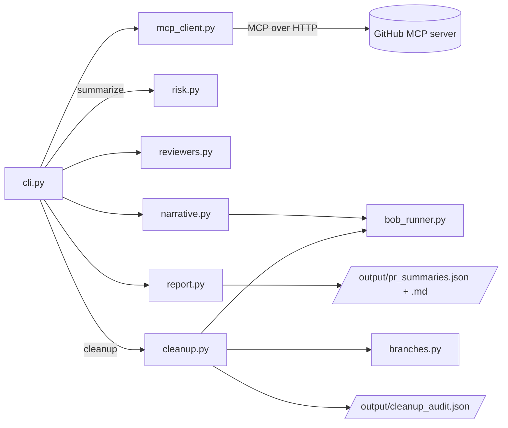

# Developer Guide: Automated PR Assistant

Written by Member 3 (foundation and MCP). Read this before you start your module.

## 1. What we are building

A Python tool that connects to GitHub through the **remote GitHub MCP server** and:

1. reads every open pull request,
2. writes a review summary per PR: title, changed files, risk flag, suggested reviewers,
3. deletes merged branches older than 7 days, through Bob Shell, with no manual git commands.

Deliverables: a working `.bob/mcp.json`, a sample output of PR summaries, and a terminal recording of the cleanup.

### Ground rules (from the problem statement)
- The **risk flag and the reviewers come from fixed rules**, not from the AI. Bob only writes the short narrative summary and runs the branch deletion.
- Cleanup is a **dry run by default**. It deletes only when `--execute` is passed.
- **Protected branches** (`main`, `master`, `develop`, `release/*`) are never deleted.
- We use the **remote** GitHub MCP server over HTTP. No Docker.
- **Tokens and keys go in environment variables or `.env`, never in git.**
- Each person owns their own files, so we avoid merge conflicts.

## 2. Data flow



`summarize`: list open PRs, fetch each PR's files, then `risk.assess`, `reviewers.suggest`, `narrative.summarize`, then `report.write`.
`cleanup`: list branches, decide eligibility, print a dry-run table, and only with `--execute` give Bob the explicit list to delete, then verify.

## 3. Project layout

| Path | Owner | Status | Purpose |
|---|---|---|---|
| `models.py` | M3 | done | Shared dataclasses. **The contract between modules.** |
| `config.py`, `config.yaml` | M3 | done | Settings loading. Thresholds live in `config.yaml`. |
| `cli.py` | M3 | done | `summarize`, `cleanup`, `all`. |
| `mcp_client.py` | M3 | done | GitHub MCP client with pagination. |
| `.bob/mcp.json` | M3 | written, not yet tested in Bob Shell | Bob's MCP server config. |
| `tests/test_mcp_client.py` | M3 | done | Mocked tests. |
| `risk.py`, `reviewers.py`, `narrative.py`, `report.py` | M4 | todo | Summary pipeline. |
| `bob_runner.py`, `branches.py`, `cleanup.py`, `orchestrate/` | M5 | todo | Branch cleanup and Orchestrate. |
| `scripts/seed_demo_repo.py` | M1 | todo | Demo data. |
| `README.md`, HLD, LLD, demo script | M2 | todo | Documentation. |

## 4. Setup

```powershell
git clone https://github.com/psl-lalit-paliwal/Automated-PR-Assistant.git
cd Automated-PR-Assistant
python -m venv .venv
.\.venv\Scripts\Activate.ps1
pip install -r requirements.txt
copy .env.example .env      # then fill in the values, see below
```

`.env` (never commit it):

| Variable | Needed for | Notes |
|---|---|---|
| `GITHUB_TOKEN` | everything | Fine-grained token: read/write on repo contents and pull requests. Ask Member 1 for it. **Never paste it in chat or in git.** |
| `GITHUB_OWNER` | everything | `psl-lalit-paliwal` |
| `GITHUB_REPO` | everything | `Automated-PR-Assistant` (the name only, not a URL) |
| `BOB_API_KEY` | `cleanup`, `all`, narrative | Created at bob.ibm.com with Scope = **Inference**. |

Run it:

```powershell
python cli.py summarize
python cli.py cleanup              # dry run, prints a table
python cli.py cleanup --execute    # really deletes
python cli.py all [--execute]
python cli.py -v summarize         # debug logging
```

Run the tests: `python -m pytest -q`

## 5. Configuration (`config.py`)

```python
from config import load_settings
settings = load_settings()                          # needs GITHUB_* in env or .env
settings = load_settings(require_bob_key=True)      # also needs BOB_API_KEY
```

`Settings` exposes: `github_token`, `github_owner`, `github_repo`, `bob_api_key`, `mcp_url`, `per_page`, `risk` (dict from `config.yaml`), `max_reviewers`, `min_age_days`, `protected_branches`, `output_dir` (a `Path`), and `raw` (the whole YAML as a dict). Its `repr` never prints secrets.

Put new thresholds in `config.yaml`, not in code. Current keys: `risk.high_changed_lines` (500), `risk.high_changed_files` (30), `risk.sensitive_paths`, `risk.medium_changed_lines` (150), `risk.medium_changed_files` (10), `risk.test_path_markers`, `reviewers.max_suggestions` (3), `cleanup.min_age_days` (7), `cleanup.protected_branches`, `output.dir`.

## 6. Shared models (`models.py`)

Do not change a field without telling the other developers.

| Model | Fields | Used by |
|---|---|---|
| `ChangedFile` | `filename, additions, deletions, status`; property `changes` | mcp_client, risk |
| `PullRequest` | `number, title, author, url, head_branch, base_branch, files`; properties `changed_files`, `total_changed_lines` | everyone in summarize |
| `RiskLevel` | `LOW`, `MEDIUM`, `HIGH` (string enum) | risk, report |
| `RiskAssessment` | `level: RiskLevel, reasons: tuple[str, ...]` | risk, report |
| `PullRequestSummary` | `number, title, author, url, changed_files, risk, suggested_reviewers, summary`; method `to_dict()` | report |
| `Branch` | `name, sha, protected, is_fork, last_commit_date, pr_number, pr_merged` | branches, cleanup |
| `BranchDecision` | `branch, eligible, reason, age_days`; method `to_dict()` | branches, cleanup |

`PullRequest`, `Branch`, `ChangedFile`, `RiskAssessment` and `BranchDecision` are **frozen**. Use `dataclasses.replace(obj, field=value)` to get a changed copy.

`PullRequestSummary.to_dict()` produces the exact JSON shape required for `output/pr_summaries.json`:

```json
{
  "number": 12, "title": "...", "author": "...", "url": "...",
  "changed_files": ["a.py"],
  "risk": {"level": "high", "reasons": ["..."]},
  "suggested_reviewers": ["alice"],
  "summary": "..."
}
```

## 7. What the CLI expects from your module

`cli.py` imports your module only when needed, and prints a clear message if it is missing. **Match these signatures**, or tell Member 3 so the CLI can change.

### Member 4 (summary pipeline)
```python
risk.assess(pr: PullRequest, settings: Settings) -> RiskAssessment
async reviewers.suggest(pr: PullRequest, client: GitHubMCPClient, settings: Settings) -> list[str]
narrative.summarize(pr: PullRequest, risk: RiskAssessment, settings: Settings) -> str
report.write(summaries: list[PullRequestSummary], settings: Settings) -> None
```
`pr.files` is already filled in by the CLI when your functions are called. `report.write` creates `settings.output_dir` and writes `pr_summaries.json` and `pr_summaries.md`.

### Member 5 (cleanup)
```python
async cleanup.run(client: GitHubMCPClient, settings: Settings, execute: bool) -> list[BranchDecision]
```
`--execute` is `False` by default. `bob_runner.py` needs `settings.bob_api_key`.

## 8. The MCP client (`mcp_client.py`)

```python
async with GitHubMCPClient(settings) as client:
    prs      = await client.list_open_prs()          # list[PullRequest], files empty
    files    = await client.get_pr_files(42)         # list[ChangedFile]
    branches = await client.list_branches()          # list[Branch], dates not filled
    date     = await client.get_commit_date(sha)     # datetime (timezone-aware)
```

- All four methods **paginate** automatically (page size `github.per_page`, stops on a short page).
- Errors raise `MCPError`.
- It reads `GITHUB_OWNER` and `GITHUB_REPO` from settings. For other calls (for example `list_commits` for recent authors, or `get_file_contents` for CODEOWNERS), use the internal `client._call("tool_name", **args)`. Owner and repo are added for you. Ask Member 3 if you want a public method added.
- **Testing without network:** `GitHubMCPClient(settings, session=fake)`, where `fake` has an async `call_tool(name, arguments)` returning an object with `.is_error` and `.content[0].text`. See `tests/test_mcp_client.py` for a ready `FakeSession`.

## 9. GitHub MCP facts (verified against the live server)

Endpoint `https://api.githubcopilot.com/mcp/`, header `Authorization: Bearer <token>`, 46 tools. The ones we use:

| Need | Tool | Key arguments |
|---|---|---|
| Open PRs | `list_pull_requests` | `owner, repo, state=open, page, perPage` |
| Closed or merged PRs (match branch to PR) | `list_pull_requests` | `state=closed`. Each item has a `merged` flag. |
| PR files | `pull_request_read` | `method=get_files, pullNumber, page, perPage` |
| Branches | `list_branches` | `owner, repo, page, perPage` |
| Commit date | `get_commit` | `sha, detail=none` |
| Recent authors of a file | `list_commits` | `path, perPage` |
| CODEOWNERS | `get_file_contents` | `path=.github/CODEOWNERS` |

Response notes:
- Results come back as JSON text in `content[0].text`. `mcp_client.py` parses it for you.
- A file item has `filename, status, additions, changes` but **no `deletions`**. The client computes `deletions = changes - additions`.
- A branch item has `name, sha, protected`. It has **no commit date**, so call `get_commit_date(sha)` for each branch.
- A commit date is at `commit.committer.date`.

### Branch delete is NOT available through MCP
The server has **no `delete_branch` tool**. The only delete-like tool is `delete_file`, which removes a file, not a branch. This is a design problem for `cleanup.py` (Member 5). The options:
1. Bob Shell runs the delete itself, through its shell tool: `git push origin --delete <branch>` or `gh api -X DELETE repos/<owner>/<repo>/git/refs/heads/<branch>`.
2. `cleanup.py` calls the GitHub REST API directly.

Either way, verification afterwards can still use `list_branches` over MCP. The team needs to decide which option to use.

## 10. Bob Shell and `.bob/mcp.json`

```json
{
  "mcpServers": {
    "github": {
      "url": "https://api.githubcopilot.com/mcp/",
      "headers": { "Authorization": "Bearer ${GITHUB_TOKEN}" }
    }
  }
}
```

**Not yet tested inside Bob Shell.** Open questions to check once Bob Shell is installed:
- Does Bob Shell expand `${GITHUB_TOKEN}` inside `headers`? The Bob docs do not say. If it does not, the 401 response will show the literal text. Fallback: generate the file at run time, never commit a real token.
- Is `"type": "streamable-http"` needed? The Bob Shell docs show only `url`. The IDE docs show the `type` line.
- `bob run` needs `BOB_API_KEY` (an Inference-scope key). Without it, it exits with an authentication error.

## 11. Rules for working together

- **Never commit** `.env`, tokens or API keys. `.gitignore` already excludes `.env`, `.venv/` and `output/`. Commit `.env.example` with **empty** values only.
- Do not change `models.py` or `config.yaml` keys without telling the team. Add new keys, do not rename old ones.
- Keep your work in your own files. If you need a change in someone else's file, ask the owner.
- Write unit tests for your module with mocks. No test may need the network or a real token.
- Before pushing: `python -m pytest -q` must pass.
- Reset demo data between end-to-end runs by re-running `scripts/seed_demo_repo.py`.

## 12. Known gaps and next steps

| # | Gap | Owner |
|---|---|---|
| 1 | Test `.bob/mcp.json` in Bob Shell (`${VAR}` expansion, `type` line) | M3 |
| 2 | Decide how branches are deleted, since MCP has no tool for it | M5 and team |
| 3 | The demo repo is empty. Response shapes for PRs and branches were verified on a public repo, so re-check them on the seeded repo. | M1 and M3 |
| 4 | Implement the modules listed in section 3 as `todo` | M4, M5 |
| 5 | Run `cli.py summarize` end to end once M4 lands | M3 |
